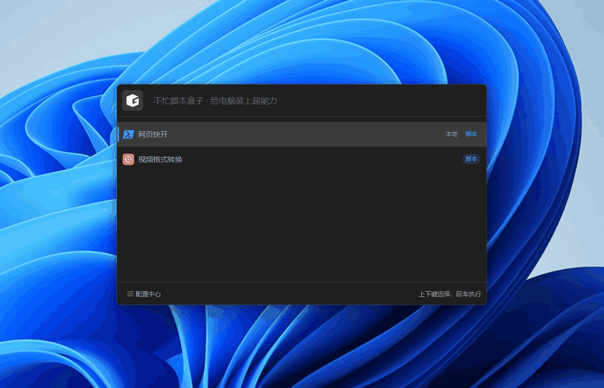

# 网页快开

> 在盒子搜索框里输入或粘贴网址，选中「网页快开」即可用系统默认浏览器打开。

---

## 核心特性

- **搜索即开**：在盒子里输入网址，选中脚本直接打开，不用切换浏览器、不用复制粘贴
- **自动补全协议**：`example.com` 自动补 `https://`，`localhost:8080` 自动补 `http://`
- **多种网址形式**：普通链接、省略协议的域名、本地地址、`mailto:` / `ftp://` 都能处理
- **不弹终端**：从搜索框打开时静默运行，不会闪出命令行窗口

---

## 脚本演示

---

## 安装方法

本脚本的运行环境、依赖组件及图形化窗口均依赖"不忙脚本盒子"，建议仅通过盒子安装和使用本脚本。

> 前置条件：安装好 [不忙脚本盒子](https://www.bm-box.cn)

* 打开盒子 → **脚本市场** → 搜索 **「网页快开」**
* 点击「安装」

---

## 使用方式

### 搜索框启动

1. 在盒子主界面搜索框输入网址，例如 `https://www.bilibili.com`、`example.com`、`localhost:8080`
2. 搜索结果里出现「网页快开」，点击或按回车选中
3. 默认浏览器立刻打开这个网址

### 直接启动

在盒子里点击「网页快开」卡片，终端会提示你输入网址，回车后打开。

---

## 💡 使用提示

| 输入 | 实际打开 |
| --- | --- |
| `https://example.com/a?b=1` | 原样打开 |
| `example.com` / `example.com/path` | 自动补 `https://` |
| `www.example.com` | 自动补 `https://` |
| `localhost:8080` / `127.0.0.1:8000` | 自动补 `http://` |
| `mailto:a@b.com`、`ftp://...` | 原样交给系统 |
| 带空格、或不像网址的文本 | 不打开，提示「不是可打开的网址」 |

---

## 🖥️ 环境要求

| 项目 | 要求 |
| --- | --- |
| **操作系统** | Windows 10 及以上 |
| **运行环境** | PowerShell 5.1 及以上（盒子自动准备，无需自行安装） |
